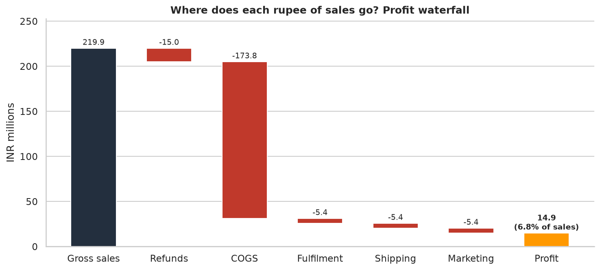
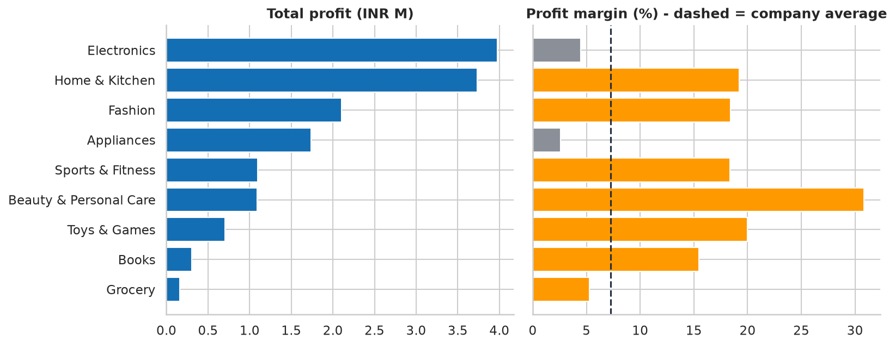
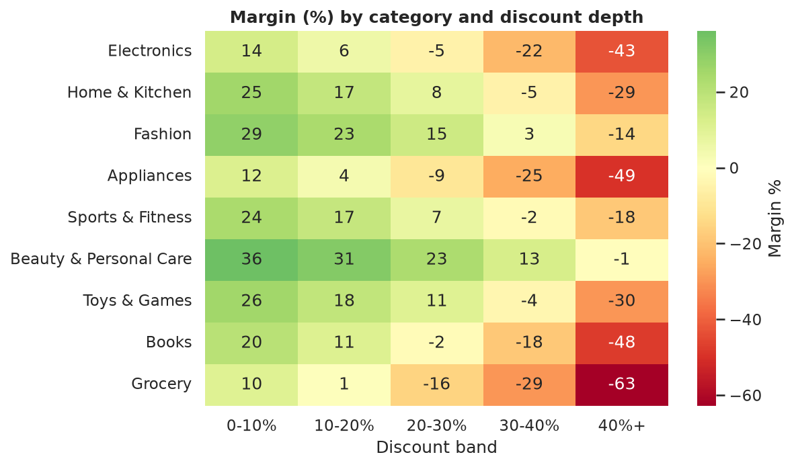
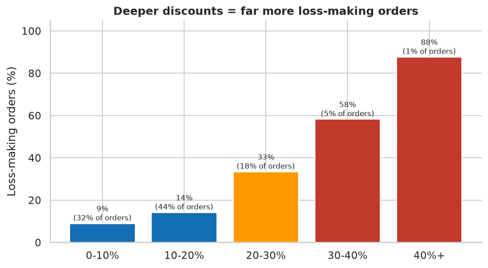
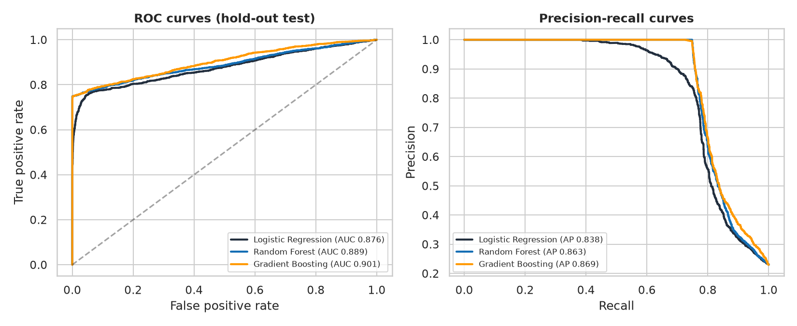
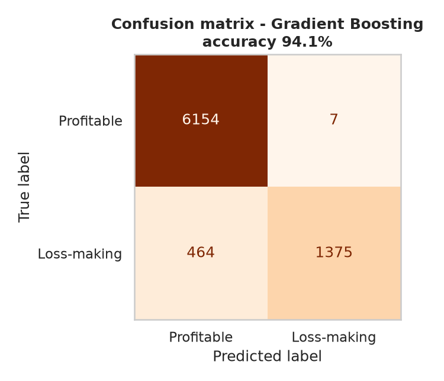
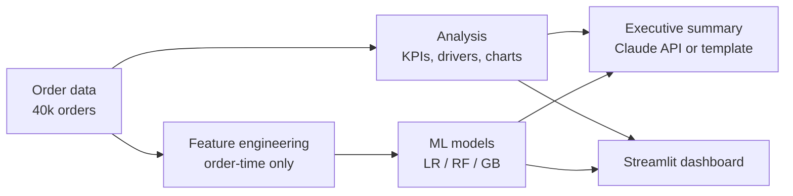

# 📦 Amazon Marketplace Profit Analytics


> **End-to-end analytics project:** order-level P&L analysis, discount and returns economics, an ML model that flags
> loss-making orders **before they ship**, a what-if pricing simulator and an interactive Streamlit dashboard.

**Live dashboard:** _add your Streamlit Cloud link here_  |  **Notebook:** [`notebooks/Amazon_Profit_Analysis.ipynb`](notebooks/Amazon_Profit_Analysis.ipynb)

---

## 🎯 Business problem
An Amazon-style retailer grows revenue every festive season but margins shrink. Leadership asks:
1. **Where** do we make and lose money (category, region, shipping, discount depth)?
2. **Why** do orders lose money, and how much is avoidable?
3. Can we **predict** a loss-making order at checkout, and what would a **discount cap** be worth?

## 📌 Headline results
| | |
|---|---|
| Orders analysed | **40,000** (Jan 2024 - Dec 2025) |
| Net revenue / profit | **INR 204.87M** / **INR 14.9M** (7.27% margin) |
| Loss-making orders | **18.9%** - 77.3% of them involve a >20% discount or a return |
| Festive-season margin | **2.34%** vs 9.83% in regular months (avg discount 18.8% vs 12.7%) |
| Best / worst margin category | **Beauty & Personal Care** (30.8%) / **Appliances** (2.6%) |
| Returns | 6.8% of orders, costing **INR 6.38M** |
| **Recommendation** | Cap discounts at 25% -> **+INR 2.01M profit (+13.5%)**, even if 15% of affected orders are lost |
| **ML model** | Gradient Boosting: **94.1% accuracy**, 99.5% precision, AUC 0.902 on a chronological hold-out |

## 🖼️ Selected visuals





## 🤖 Machine learning
**Task:** predict `is_loss_making` for each order using only information available at order time.

| Model | CV accuracy | **Test accuracy** | Precision | Recall | F1 | ROC-AUC |
|---|---|---|---|---|---|---|
| Logistic Regression | 91.8% | **91.0%** | 93.8% | 65.2% | 0.769 | 0.876 |
| Random Forest | 94.1% | **94.2%** | 100.0% | 74.8% | 0.856 | 0.889 |
| Gradient Boosting | 94.0% | **94.1%** | 99.5% | 74.7% | 0.853 | 0.902 |

Majority-class baseline accuracy: **77.0%**. Best model chosen by cross-validated AUC (never by the test set).



### Why is this accuracy trustworthy?
- **Chronological split.** Trained on 32,000 past orders, tested on the **most recent 8,000** (2025-09-24 to 2025-12-31), mimicking real deployment.
- **No data leakage.** Outcome columns (`returned`, `net_revenue`, `profit`, ...) are excluded; this is enforced by an assertion in code **and a unit test**.
- **Beats a naive baseline** by 17 points, not just "high accuracy on an easy problem".
- **Honest error analysis.** Of 1,839 true loss-makers the model caught 1,374 (75%); **99.4% of the misses were caused by customer returns**, which are unknowable at order time. Precision is 99.5% - flagged orders are almost always real losses.



## 🧱 Project architecture


## 🛠 Tech stack
Python - pandas, NumPy - scikit-learn (pipelines, CV, permutation importance) - matplotlib, seaborn, Plotly - Streamlit - Jupyter - pytest - GitHub Actions - Anthropic API (optional)

## 🚀 Run it
```bash
git clone https://github.com/montyy123/amazon-profit-analytics.git
cd amazon-profit-analytics
python3 -m venv .venv && source .venv/bin/activate     # Windows: .venv\Scripts\activate
pip install -r requirements.txt
python main.py            # data -> analysis -> models -> summary  (~1 min)
streamlit run app.py      # interactive dashboard at http://localhost:8501
pytest -q                 # data-integrity, leakage and accuracy tests
```
Optional AI-written summary: `export ANTHROPIC_API_KEY=...` before `python main.py` (a template summary is used otherwise).

## 📁 Repository structure
```
├── main.py                       # one-command pipeline
├── app.py                        # Streamlit dashboard (5 tabs, what-if simulator, live predictor)
├── src/
│   ├── generate_data.py          # order-level P&L simulation
│   ├── analysis.py               # KPIs, charts, waterfall, discount scenarios
│   ├── model.py                  # features, CV, chronological evaluation, explainability
│   └── insights.py               # LLM / template executive summary
├── notebooks/Amazon_Profit_Analysis.ipynb   # executed walkthrough
├── tests/test_pipeline.py        # pytest suite
├── .github/workflows/ci.yml      # CI: run pipeline + tests on every push
├── data/amazon_orders.csv
└── reports/                      # figures, metrics.json, executive_summary.md, risk list
```

## 📖 Data dictionary (key columns)
| Column | Meaning |
|---|---|
| `list_price`, `discount_pct`, `selling_price` | Pricing decision |
| `unit_cost`, `fulfilment_cost`, `shipping_cost`, `marketing_cost` | Cost to serve, known at order time |
| `customer_return_rate` | Customer's historical return propensity |
| `returned` | Outcome: order returned (**not used as a feature**) |
| `net_revenue`, `cogs_recognised`, `return_shipping_cost` | Post-outcome P&L lines (**not used as features**) |
| `profit`, `profit_margin_pct`, `is_loss_making` | Outcomes / target |

P&L identity: `profit = net_revenue - COGS - fulfilment - shipping - marketing - return shipping` (verified by a unit test).

## ⚠️ Limitations (read this)
- **The data is synthetic.** It encodes realistic retail economics (thin electronics margins, heavy fashion returns, festive discounting, costly same-day delivery) but it is **not Amazon's data**. Absolute numbers illustrate the method; the model accuracy reflects the simulated structure and would be lower on messy real data.
- Because profit follows deterministically from known costs plus returns, loss-making orders are easier to predict here than in real life. Real deployments should add noisier signals (competitor pricing, stock-outs, ad auctions).
- The discount-cap scenario assumes a flat 15% volume loss; real price elasticity should be estimated with an A/B test.

## 🔭 Next steps
SHAP explanations - return-risk model - price-elasticity estimation from experiment data - cost-sensitive thresholding - MLflow tracking - swap in a real order export (e.g. a Kaggle e-commerce dataset mapped to the same columns).

## 👤 Author
**Souvik Kumar Mohanty** - [GitHub](https://github.com/montyy123) - souvik2mohanty201617@gmail.com
